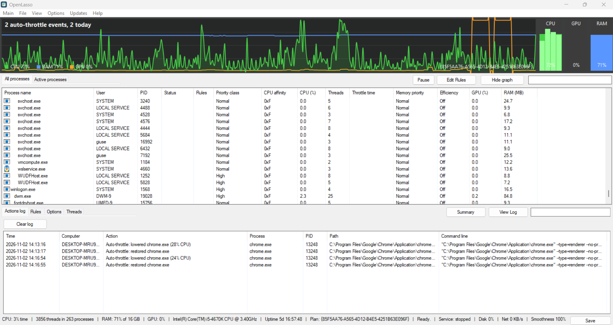

# OpenLasso 1.0

OpenLasso is an open-source process and resource manager for Windows 10 and 11, written in C++17 with native Win32 APIs (no heavy frameworks).
It monitors processes, CPU, RAM, GPU, disk and network in real time, changes process priorities and applies custom automatic rules.

by watergamer111

> OpenLasso is an independent project written from scratch. It is not affiliated with, endorsed by or derived from any commercial software. All product names and trademarks mentioned anywhere belong to their respective owners.

   

## Main features
- **Processes**: priority, CPU affinity, CPU Sets, memory priority, I/O priority, efficiency mode, thread boost, GPU priority and GPU preference, prevent sleep, high-power mode per process.
- **Rules** match a program by name, by full path, by folder (trailing backslash) or with wildcards (`*`, `?`). A rule named `*` is the **default rule**: it applies to every process that no other rule covers.
- **CPU cap**: pauses a process whose CPU use exceeds a percentage (`Cap CPU`).
- **CPU guard**: after N seconds above a CPU threshold, lowers the priority, closes the process or runs a command.
- **Block**: closes a program as soon as it starts.
- **Instance spreading**: spreads several instances of the same program over different CPUs.
- **Auto-throttle**: lowers background processes that use much CPU when the system is busy; the duration before lowering is configurable (1, 2, 5, 10 s). Every event is recorded in `OpenLasso-throttle.csv`.
- **Memory Trim**, **Idle power saver**, **Stay awake**, dynamic power profiles, own high-power plan.
- **Monitoring**: CPU graph with per-core bars, RAM, GPU, disk usage and network throughput in the status bar.
- **Background operation**: system tray icon, tray balloons for events, optional start with Windows (elevated scheduled task, no UAC prompt).
- **Windows service**: applies the rules with the window closed. While the service runs, the window leaves rule application to it (setting "Let the Windows service apply rules when it runs").
- **Profiles** and persistent configuration (`OpenLasso.json`, `OpenLasso-<name>.json`).
- **Command line** for scripts:

```
OpenLasso.exe --version
OpenLasso.exe --status
OpenLasso.exe --list
OpenLasso.exe --apply
OpenLasso.exe --profile <name> --apply
OpenLasso.exe --help
```

## Threads and processor groups
- **Threads tab**: lists the threads of the selected process with priority, CPU use and time. Right-click a thread to change its priority, affinity (first group only), boost, or to suspend and resume it.
- **More than 64 CPUs**: the menu entry "Use all processor groups" spreads a process over all processor groups; threads are distributed round robin, since a thread belongs to one group.
- **Smoothness**: a probe thread asks the scheduler to wake it every 10 ms and measures the delay. 100% means no measurable delay; 0% means 50 ms or more on average. It is an estimate, shown in the status bar.

## Build
Run `build.bat` (MSVC or g++; a portable compiler is downloaded if neither is installed) or use the CMake file.
Libraries: comctl32, comdlg32, powrprof, psapi, winhttp, gdiplus, pdh, ole32, shell32, advapi32.

## Files next to the exe
- `OpenLasso.json` default profile; other profiles as `OpenLasso-<name>.json`
- `OpenLasso.log` action log (size limit in the settings)
- `OpenLasso-throttle.csv` Auto-throttle report
- `OpenLasso-service.status` heartbeat written by the service

## Limits
- Email notifications: only tray balloons are available.
- Automatic updates with a background installer: only manual checks (Updates menu) are available.
- Signed installer: the executable is not code-signed.
- Localization: English only.
- Remote management: not available.

[**Download the latest release**](../../releases/latest)

> **Note:** on first launch OpenLasso starts hidden and runs in the background, so no window will open.
> Look for its icon in the Windows system tray: click the small arrow (^) next to the clock, then click the icon to open the window.
